  

  
  
  
  
  

  

---

## About

I am an **NUS Computer Engineering student** (**AI Minor, Advanced Electronics & IoT**) focused on building AI systems that interface directly with physical hardware.

Education: **NUS Computer Engineering**, **AI Minor**, **Advanced Electronics & IoT**.

My work is organized around an internal/external AI split, grounded in hardware systems:

<table>
  <tr>
    <td width="33%" valign="top">
      <strong>Internal AI / Model Layer</strong> 
      Applied ML, computer vision, local inference 
      training, evaluation, model behavior 
      perception and adaptation
    </td>
    <td width="34%" valign="top">
      <strong>External Agent / Workspace Layer</strong> 
      prompts, roles, skills, memory, tool runtimes 
      CLI agents, Telegram/Discord surfaces, phone and workspace workflows 
      modular behavior across agents and runtimes
    </td>
    <td width="33%" valign="top">
      <strong>Hardware / Systems Layer</strong> 
      Robotics, embedded systems, C/C++, assembly 
      ROS 2, sensors, control loops, latency-aware programming
    </td>
  </tr>
</table>

I am driven to build end-to-end systems where AI does not just process data, but physically interacts with and controls real-world hardware.

Currently: **Software Robotics Intern (Solo On-Site Deployment) at KABAM Robotics**, internship May 2026 – Dec 2026. From Jul 2026 to Oct 2026 I ran its first Singapore field PoC of the latest patrol robot model as the solo on-site engineer, across ROS 2, MQTT, Docker, Jetson Orin AGX, SAM3, Nav2, C++ and Python. Previously taught **CS2113 Software Engineering & OOP** at NUS.

Recognition: **Singapore Defence Tech Hackathon — Finalist, Top 6, LOTR track** · **DSTA BrainHack CODE_EXP — Open Finalist** · **Vibe For Good — Semi-Finalist**.

---

## Tech Stack

<table>
  <tr>
    <td width="20%"><strong>Languages</strong></td>
    <td>
      
      
      
      
      
      
      
      
      
    </td>
  </tr>
  <tr>
    <td><strong>AI / ML</strong></td>
    <td>
      
      
      
      
      
      
      
      
    </td>
  </tr>
  <tr>
    <td><strong>Agents / Surfaces</strong></td>
    <td>
      
      
      
      
      
      
      
      
      
    </td>
  </tr>
  <tr>
    <td><strong>Robotics / Systems</strong></td>
    <td>
      
      
      
      
      
      
      
      
      
    </td>
  </tr>
</table>

---

## Featured Work

<table>
  <tr>
    <td width="50%" valign="top">
      <h3><a href="https://yxiang-828.vercel.app/projects/aiko.html">Aiko</a></h3>
      
<strong>Personal OS Agent</strong>

      
Local daemon, phone app, Telegram bridge, memory system, voice, tool runtime, and CLI-agent workers wired into one personal automation layer.

      

        
        
        
        
        
      

      
Private research build. Demo on request.

    </td>
    <td width="50%" valign="top">
      <h3><a href="https://yxiang-828.vercel.app/projects/kampung-kaki.html">Kampung Kaki</a></h3>
      
<strong>DSTA BrainHack CODE_EXP Open Finalist</strong>

      
Role-aware emergency coordination map for citizens, responders, and operations teams with SOS/report flows and grounded AI guidance.

      

        
        
        
        
        
      

    </td>
  </tr>
  <tr>
    <td width="50%" valign="top">
      <h3><a href="https://yxiang-828.vercel.app/projects/planai.html">PLAN.AI</a></h3>
      
<strong>Deep-Research Architect Co-Pilot</strong>

      
Researches across 9 sources and compiles inline-cited 22-section technical blueprints with Mermaid C4 diagrams and implementation tasks.

      

        
        
        
        
      

    </td>
    <td width="50%" valign="top">
      <h3><a href="https://github.com/Yxiang-828/Synapxe_IMDA_AI_Innovation_Challenge">Mera</a></h3>
      
<strong>Digital Health Companion</strong>

      
Telegram-native health companion with Singapore AI models, multimodal voice/vision flows, and on-device clinical mini-apps.

      

        
        
        
        
        
      

    </td>
  </tr>
  <tr>
    <td width="50%" valign="top">
      <h3><a href="https://github.com/Yxiang-828/TinyFish-SG-Hackathon">Shoppo</a></h3>
      
<strong>Telegram Shopping Agent</strong>

      
Turns vague text, photos, and budgets into structured marketplace searches and evidence-backed ranked shortlists.

      

        
        
        
        
      

    </td>
    <td width="50%" valign="top">
      <h3><a href="https://github.com/Yxiang-828/Wingman">Wingman</a></h3>
      
<strong>Local AI Desktop Assistant</strong>

      
Offline-first desktop productivity app with task management, calendar, mood diary, Ollama chat, SQLite persistence, and packaged distribution.

      

        
        
        
        
      

    </td>
  </tr>
</table>

---

## Hackathons

| Year | Hackathon | Project |
| --- | --- | --- |
| 2026 | **Singapore Defence Tech Hackathon — Finalist, Top 6, LOTR track** | Marsham Edge |
| 2026 | **DSTA BrainHack CODE_EXP — Open Finalist** | Kampung Kaki |
| 2026 | **Vibe For Good — Semi-Finalist** | VibeCheck |
| 2026 | AI Engineer Hackathon | PLAN.AI |
| 2026 | NUS × Synapxe × IMDA AI Innovation Challenge | Mera |
| 2026 | TinyFish SG Hackathon | Shoppo |
| 2026 | VibeWithSG × Duality AI | off-road terrain segmentation, solo, test mIoU 0.42 |
| 2026 | Hack4Good | Care Guardian System |
| 2025 | HacX CS7 | Dual-Mode AV Disruptor |
| 2026 | Tencent Cloud Age Well Social Good Challenge | AnAn |
| 2026 | Huawei Tech4City | Replay |

  <strong>Open to internships from Jan 2027 in AI and agent engineering, software and systems, or edge AI and robotics.</strong>

---

This repository is the one source for this profile, [my website](https://yxiang-828.vercel.app), its guide Holo and [my résumé](https://yxiang-828.vercel.app/v2media/resume/Yao_Xiang_Resume_General.pdf): all four are built from [`content/facts.json`](content/facts.json). How it fits together: [docs/REPO.md](docs/REPO.md).
