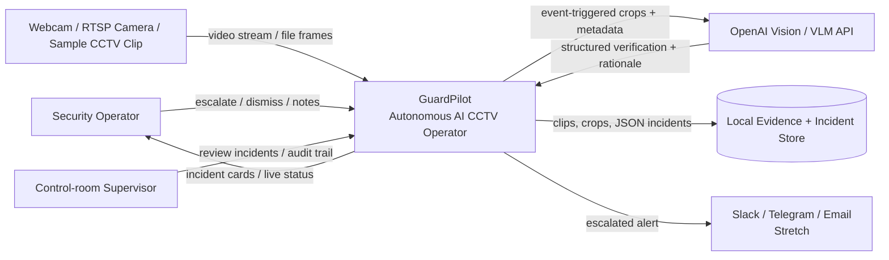
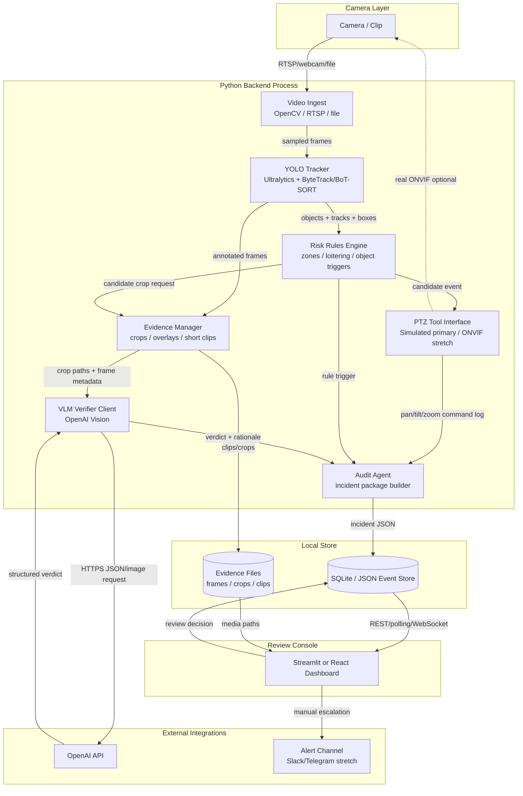
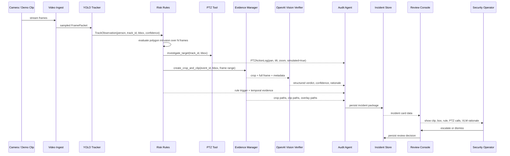
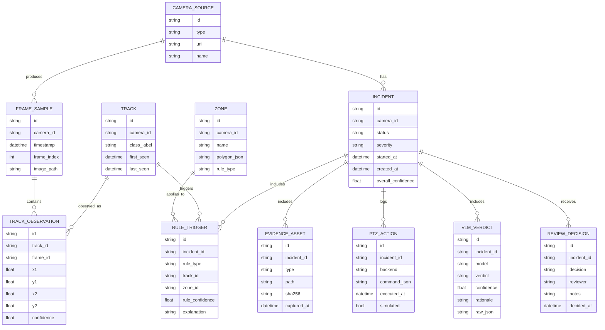

# 1. Executive Summary

- **Build:** GuardPilot, a 24-hour hackathon MVP that turns a CCTV/webcam/sample feed into an agentic security loop: observe → track → investigate → verify → audit → review, driven by the `mvpDefinition` and `demoFlow`.
- **Users:** Security operations teams, facility managers, and control-room operators who need fewer noisy CCTV alerts and faster review, per `targetPersona`.
- **Stack:** Python + OpenCV + Ultralytics YOLO tracking, simulated PTZ tool, OpenAI Vision/VLM verification, SQLite/JSON event store, and Streamlit or React review console, chosen for `timeBudget`, `skillInventory`, and lightweight YOLO/RTSP patterns [8], [10], [25].
- **Main risk:** Weapon-like object detection and real ONVIF PTZ are unreliable under hackathon constraints, so restricted-zone intrusion and simulated PTZ are the primary demo path, per `topRisks`, `fallbackPlan`, and ONVIF friction evidence [16], [17], [18], [20].
- **Demo shape:** A person enters a restricted zone; GuardPilot tracks them, simulates pan/zoom, sends cropped evidence to OpenAI Vision, logs an audit trail, and displays an incident card with evidence, reasoning, confidence, PTZ calls, and Escalate/Dismiss controls, matching `moneyShot`.

---

# 2. Context & Problem

Security teams monitor many passive CCTV feeds and receive noisy motion/object alerts with little context. Real incidents can be missed because operators must constantly watch video or later review footage manually. Existing AI camera systems often detect generic objects but do not reliably combine temporal tracking, site-specific rules, active PTZ investigation, VLM-based verification, and explainable audit trails. This blueprint follows the `problemStatement` and positions GuardPilot as an AI-native control-room assistant, not an autonomous enforcement system, per `nonGoals`.

---

# 3. Goals

- **End-to-end vertical slice:** Ingest 1 live webcam/RTSP/sample video feed and complete observe → track → investigate → verify → audit → review during the demo, per `mvpDefinition`.
- **Detection and tracking:** Run YOLO tracking on sampled frames with persistent track IDs for at least `person` class and optional suspicious-object classes, using Ultralytics tracking support [10].
- **Primary risk rule:** Trigger restricted-zone intrusion when a tracked person’s center point or foot point remains inside a configured polygon for ≥1 second or ≥5 sampled frames.
- **PTZ investigation:** Execute a simulated PTZ pan/tilt/zoom command within 500 ms of rule trigger and log the command in the incident audit trail, per `fallbackPlan`.
- **VLM verification:** Send 1–3 event-triggered crops/frames to OpenAI Vision only after a local rule fires, keeping API spend under the `costCeiling` of approximately USD $25–50 [25].
- **Incident dashboard:** Display incident cards with clip/crop, bounding boxes, track ID, rule reason, VLM rationale, confidence, PTZ tool calls, and Escalate/Dismiss controls.
- **Critical path:** By hour 12, deliver video ingest + YOLO tracking + one risk rule + event record + basic dashboard, per `criticalPath`.

---

# 4. Non-Goals

- **No facial recognition:** GuardPilot will not identify people, compare faces, or build biometric profiles, per `nonGoals`.
- **No punitive autonomous decisions:** The system will not make final enforcement, disciplinary, or law-enforcement decisions without human review, per `nonGoals`.
- **No custom model training during hackathon:** The MVP uses pre-trained YOLO models and rule logic, not custom suspicious-activity training, per `antiStack`.
- **No dependency on physical PTZ hardware:** Real ONVIF/PTZ is stretch only; simulated PTZ is the primary path because camera authentication and command semantics are risky within 24 hours, per `hardwareConstraints` and ONVIF implementation friction [17], [18], [20].
- **No broad event taxonomy:** MVP focuses on restricted-zone intrusion first; loitering, abandoned object, weapon-like detection, Slack/Telegram, multi-camera, and privacy masking are stretch goals, per `stretchGoals`.
- **No production compliance claim:** “Audit-ready” means review-ready evidence trail for demo purposes, not legal admissibility or full regulatory chain-of-custody.
- **No complex distributed microservices:** A single-machine monolith or lightweight backend + UI is preferred due to `timeBudget`, `teamComposition`, and `antiStack`.

---

# 5. Stakeholders & Personas

| Persona | Needs | How GuardPilot serves them |
|---|---|---|
| **Security operator** | Triage incidents quickly without watching all feeds constantly | Incident cards with evidence, explanation, confidence, and Escalate/Dismiss controls |
| **Control-room supervisor** | Reduce false alarms and ensure operators review important events | Audit trail and severity-based queue |
| **Facility manager** | Monitor restricted areas, warehouses, campuses, malls, or offices | Site-specific polygon zones and incident history |
| **Hackathon judges** | Evaluate autonomy, explainability, reliability, demo clarity, and OpenAI/Codex leverage | Full vertical loop from video ingest to review UI, per `judgingCriteria` |
| **Engineering team** | Ship within 8 hours | Python/OpenCV/YOLO/OpenAI/Streamlit path aligned with `skillInventory` |
| **Compliance/privacy reviewer, future phase** | Ensure surveillance system avoids prohibited biometric or punitive use | Non-goals, data retention limits, human-in-the-loop review |

---

# 6. Constraints

- **Time:** 24 hours total; hour 12 must have ingest + tracking + rule + event + dashboard working, per `timeBudget` and `criticalPath`.
- **Budget:** OpenAI API spend should remain under approximately USD $25–50 by using event-triggered crops, per `costCeiling`.
- **Hardware:** Must run on a laptop with webcam, RTSP, or sample CCTV video; GPU is helpful but not required if using lightweight YOLO and frame sampling, per `hardwareConstraints`.
- **PTZ risk:** Real ONVIF control is optional because PTZ credentials, stream URLs, and command support can consume excessive time, per `fallbackPlan` and ONVIF complexity reports [16], [17], [18], [20].
- **Team skills:** Assumes Python, OpenCV, Ultralytics YOLO, basic tracking, API integration, and web dashboard development, per `skillInventory`.
- **Regulatory/ethical:** No facial recognition, no law-enforcement automation, no punitive decisions, and human review remains mandatory, per `nonGoals`.
- **Reliability:** VLM can be ambiguous or miss details, so it is a verifier/explainer after deterministic local triggers, not the source of truth [24], [25].

---

# 7. Solution Strategy

Build a single-machine, event-driven security-agent demo where local YOLO tracking continuously observes the feed, deterministic rules select high-signal incidents, a PTZ tool simulates active investigation, OpenAI Vision verifies only event crops, and a review dashboard exposes the complete audit trail; this architecture directly follows the `timeBudget`, `costCeiling`, `fallbackPlan`, `mvpDefinition`, and lightweight YOLO/RTSP implementation patterns [8], [10], [25].

---

# 8. Architecture

## 8.1 Context Diagram — C4 Level 1

**Decision basis:** The black-box system explicitly supports live/sample ingest, tracking, risk trigger, PTZ action, VLM verification, audit logging, and review dashboard required by `judgingCriteria`.

---

## 8.2 Container Diagram — C4 Level 2

**Decision basis:** The containers mirror the provided topology and prioritize a shippable monolith instead of microservices, per `antiStack` and `teamComposition`.

---

## 8.3 Component Breakdown

### Camera / Clip

- **Responsibilities:** Provide video frames from webcam, RTSP URL, or prerecorded demo clip.
- **Inputs:** Physical camera, RTSP stream, or local `.mp4`.
- **Outputs:** Frame stream.
- **Decision basis:** Supports `hardwareConstraints` and `fallbackPlan`.

### Video Ingest

- **Responsibilities:** Open source, sample frames, timestamp frames, expose current frame buffer.
- **Inputs:** Camera URL/file path, frame sampling config.
- **Outputs:** `FramePacket {frame_id, ts, image, source_id}`.
- **Decision basis:** OpenCV/YOLO RTSP pipelines are common and hackathon-friendly [8].

### YOLO Tracker

- **Responsibilities:** Detect objects, maintain track IDs, output boxes/classes/confidences.
- **Inputs:** Sampled frames.
- **Outputs:** `TrackObservation[]`.
- **Decision basis:** Ultralytics YOLO tracking supports persistent IDs over video streams [10].

### Risk Rules Engine

- **Responsibilities:** Apply site context: restricted-zone polygon, loitering timer, abandoned-object heuristic, optional suspicious-object trigger.
- **Inputs:** Track observations, zone config, temporal history.
- **Outputs:** `CandidateEvent`.
- **Decision basis:** Restricted-zone intrusion is primary due to `topRisks`; weapon-like detection is optional.

### PTZ Tool Interface

- **Responsibilities:** Simulate or execute pan/tilt/zoom action toward target bounding box; log tool calls.
- **Inputs:** Target track ID, bbox, camera frame dimensions.
- **Outputs:** `PTZActionLog`.
- **Decision basis:** Simulated PTZ is primary due to `fallbackPlan`; ONVIF stretch is risky [16], [17], [18], [20].

### Evidence Manager

- **Responsibilities:** Save crops, annotated frames, pre/post event clip snippets, thumbnails.
- **Inputs:** Frame buffer, bbox, event ID.
- **Outputs:** Evidence file paths and metadata.
- **Decision basis:** Cropped detections map to practical YOLO surveillance patterns [8].

### VLM Verifier Client

- **Responsibilities:** Send selected crops/frames and metadata to OpenAI Vision, request constrained JSON.
- **Inputs:** Crops, full frame, rule metadata.
- **Outputs:** `VLMVerdict`.
- **Decision basis:** Uses OpenAI API only on event-triggered evidence to control cost per `costCeiling`; VLMs can miss details, so they verify rather than continuously detect [24], [25].

### Audit Agent

- **Responsibilities:** Combine rule trigger, track evidence, PTZ logs, VLM rationale, confidence, and severity into one incident.
- **Inputs:** Candidate event, evidence metadata, PTZ action, VLM verdict.
- **Outputs:** `Incident`.
- **Decision basis:** Audit trail is the differentiator per `differentiator`.

### Incident Store

- **Responsibilities:** Persist incidents, review decisions, evidence references, model/tool logs.
- **Inputs:** Incident packages and review updates.
- **Outputs:** Queryable incident records.
- **Decision basis:** SQLite/JSON is sufficient for 24-hour MVP, per `antiStack`.

### Review Console

- **Responsibilities:** Display incident queue, detail cards, clips/crops, reasoning, and human controls.
- **Inputs:** Incident records, evidence files.
- **Outputs:** Escalate/dismiss decisions, notes.
- **Decision basis:** Required by `mvpDefinition`, `judgingCriteria`, and `moneyShot`.

### Alert Channel — Stretch

- **Responsibilities:** Send escalated incidents to Slack/Telegram/email.
- **Inputs:** Human-reviewed escalation.
- **Outputs:** External alert message.
- **Decision basis:** Listed as `stretchGoals`.

---

## 8.4 Runtime Views

### Critical Demo Flow: Restricted-Zone Intrusion

---

## 8.5 Data Model

---

## 8.6 API Surface

For a 24-hour MVP, these can be FastAPI endpoints or Streamlit callback functions. REST makes frontend/backend separation easier if using React.

| Endpoint | Purpose | Request | Response | Error shape |
|---|---|---|---|---|
| `GET /api/health` | Runtime health | None | `{status, version, camera_connected, detector_ready}` | `{error:{code,message}}` |
| `POST /api/sources/start` | Start webcam/RTSP/file processing | `{source_type, uri, sample_fps}` | `{source_id, status}` | `{error:{code:"SOURCE_OPEN_FAILED", message, details}}` |
| `POST /api/sources/stop` | Stop processing | `{source_id}` | `{source_id, status:"stopped"}` | `{error:{code:"SOURCE_NOT_FOUND", message}}` |
| `GET /api/incidents` | List incident cards | Query: `status, severity, limit` | `{items:[IncidentSummary], next_cursor}` | `{error:{code,message}}` |
| `GET /api/incidents/{id}` | Incident detail | Path `id` | `{incident, evidence, rule_triggers, ptz_actions, vlm_verdicts, review_decisions}` | `{error:{code:"INCIDENT_NOT_FOUND", message}}` |
| `POST /api/incidents/{id}/review` | Escalate or dismiss | `{decision:"escalate|dismiss", reviewer, notes}` | `{incident_id, status, decided_at}` | `{error:{code:"INVALID_DECISION", message}}` |
| `POST /api/zones` | Configure restricted polygon | `{camera_id, name, polygon, rule_type}` | `{zone_id, status}` | `{error:{code:"INVALID_POLYGON", message}}` |
| `GET /api/evidence/{asset_id}` | Serve crop/clip/overlay | Path `asset_id` | Binary file or signed local URL | `{error:{code:"ASSET_NOT_FOUND", message}}` |
| `POST /api/ptz/test` | Demo PTZ command | `{camera_id, command, target_bbox}` | `{backend, simulated, command_log}` | `{error:{code:"PTZ_FAILED", message}}` |
| `POST /api/incidents/{id}/verify` | Retry VLM verification | `{asset_ids}` | `{verdict, confidence, rationale}` | `{error:{code:"VLM_ERROR", retryable, message}}` |

**Decision basis:** The API reflects the MVP vertical loop and review workflow required by `mvpDefinition` and `judgingCriteria`.

---

# 9. Quality Attributes — NFRs

| Attribute | Target | Reason |
|---|---:|---|
| Video ingest | 1 source for MVP; stretch 2–4 sources | `mvpDefinition` requires one vertical slice |
| Frame processing | 5–10 sampled FPS on laptop CPU/GPU | Balances YOLO cost with `hardwareConstraints` |
| Detection-to-rule latency | p95 ≤ 750 ms after sampled frame received | Demo must feel active |
| Rule-to-PTZ command latency | p95 ≤ 500 ms | Supports “camera actively investigates” `moneyShot` |
| Rule-to-incident-card latency without VLM | p95 ≤ 2 seconds | Dashboard should update quickly |
| Rule-to-VLM-verdict latency | p95 ≤ 15 seconds | Async acceptable due to VLM latency risk in `topRisks` |
| Incident persistence durability | RPO ≤ 5 seconds; RTO ≤ 5 minutes | Local MVP store |
| UI users | 1–3 concurrent reviewers | Hackathon control-room demo |
| Availability during demo | ≥ 95% over 10-minute demo window | Realistic laptop MVP target |
| OpenAI cost | ≤ USD $50 total | `costCeiling` |
| VLM calls | ≤ 1 call per incident, max 3 images/crops | Cost and latency control |
| Evidence retention | Default 24 hours for demo artifacts | Privacy-minded MVP |
| False-positive handling | 100% of incidents require human Escalate/Dismiss | `nonGoals` human review requirement |

---

# 10. Cross-Cutting Concerns

- **Auth:** MVP can use a local shared reviewer passcode; production should use SSO/OIDC. Decision driven by `timeBudget`.
- **Observability:** Log every frame-processing error, rule trigger, PTZ call, VLM request/response ID, and review decision as JSON lines; expose `GET /api/health`.
- **Metrics:** Track FPS, detector latency, incident count, VLM latency, VLM errors, review decisions, and false-dismiss/escalate feedback.
- **Traces:** Correlate all logs by `incident_id`, `track_id`, and `frame_id`.
- **Errors:** Use structured error shape `{error:{code,message,retryable,details}}`.
- **Caching:** Cache evidence thumbnails and avoid duplicate VLM verification for the same `incident_id + asset_hash`.
- **Rate limiting:** Limit VLM verification to 6 calls/minute and 1 active call per incident to respect `costCeiling`.
- **Idempotency:** Use deterministic `incident_id` seed from `camera_id + track_id + rule_type + time_bucket` to prevent duplicate incident spam.
- **Feature flags:** `ENABLE_VLM`, `ENABLE_ONVIF_PTZ`, `ENABLE_WEAPON_RULE`, `ENABLE_ALERTS`, `USE_SAMPLE_VIDEO`.
- **i18n:** MVP English-only; store user-facing strings separately if future deployment requires multilingual control rooms.

---

# 11. Security Considerations

## Threat Model

| Threat actor | Attack path | Mitigation |
|---|---|---|
| Curious local user | Opens evidence files directly | Store under app directory; optional passcode; restrict file serving by asset ID |
| Malicious reviewer | Alters incident decision history | Append-only review log; timestamped decision records |
| External attacker | Calls local API endpoints | Bind to localhost by default; require passcode if exposed on LAN |
| Credential thief | Reads OpenAI or camera credentials from repo | `.env`, `.gitignore`, no secrets in logs |
| Prompt attacker via visual scene | Places text in camera view to influence VLM | Constrained system prompt; rule metadata separated from image content; human review |
| Vendor/API failure | VLM timeout or bad response | Async retry; fall back to rule-only incident card |

## Data Classification

- **Restricted:** Raw CCTV frames/clips, incident clips, crops with people.
- **Confidential:** OpenAI API key, RTSP credentials, ONVIF credentials.
- **Internal:** Incident JSON, VLM rationale, review notes.
- **Public:** Demo slides and anonymized architecture diagrams only.

## Secrets Handling

- Store `OPENAI_API_KEY`, RTSP credentials, and ONVIF credentials in `.env`.
- Never commit `.env`; include `.env.example`.
- Redact API keys and credentials from logs.
- For demo, prefer sample file or webcam to avoid storing real camera credentials, per `hardwareConstraints`.

## OWASP Top-10 Mapping

- **A01 Broken Access Control:** Restrict review/update endpoints with passcode; bind localhost for hackathon.
- **A02 Cryptographic Failures:** Avoid transmitting camera credentials; HTTPS for OpenAI calls; do not store secrets in plaintext repo files.
- **A03 Injection:** Validate zone polygon JSON, source URI, and review notes; never shell-execute user input.
- **A04 Insecure Design:** Human-in-the-loop review prevents automated punitive action, per `nonGoals`.
- **A05 Security Misconfiguration:** Default `DEBUG=false` for demo sharing; CORS locked to dashboard origin.
- **A07 Identification/Auth Failures:** MVP passcode is weak; document SSO as production requirement.
- **A09 Logging/Monitoring Failures:** JSON audit logs for rule, PTZ, VLM, and review actions.
- **A10 SSRF:** If RTSP/URL input is accepted, allowlist local/sample sources for demo.

---

# 12. Operational Considerations

## Deploy Strategy

- **Hackathon:** Single laptop process with Python backend and Streamlit/React UI.
- **Command:** `make demo SOURCE=sample.mp4` or `python app.py --source sample.mp4 --zones config/zones.json`.
- **Packaging:** `requirements.txt` or `uv`/Poetry; pre-download YOLO weights.
- **Decision basis:** Matches `timeBudget`, `hardwareConstraints`, and `externalDeps`.

## Rollback Plan

- If live webcam fails, switch `USE_SAMPLE_VIDEO=true`.
- If VLM fails, show rule-only incident card with “VLM pending/unavailable.”
- If YOLO weapon detection fails, switch to restricted-zone intrusion, per `fallbackPlan`.
- If React build fails, use Streamlit fallback UI.

## Runbooks

### Runbook: Camera Feed Fails

1. Check source path/RTSP URL.
2. Run `python tools/check_camera.py`.
3. Switch to sample clip.
4. Restart backend.
5. Confirm `/api/health.camera_connected=true`.

### Runbook: No Incidents Trigger

1. Confirm zone polygon overlay is visible.
2. Lower person confidence threshold from 0.5 to 0.35.
3. Confirm track center enters polygon.
4. Use prerecorded clip with known intrusion.
5. Trigger manual test event if demo is blocked.

### Runbook: VLM Timeout

1. Confirm `OPENAI_API_KEY`.
2. Check network.
3. Retry `/api/incidents/{id}/verify`.
4. Continue demo with local rule explanation.

## On-Call Structure

- Hackathon: one backend/CV owner and one frontend/demo owner.
- During judging: backend owner monitors terminal logs; presenter operates UI.

## Alert Thresholds

- Detector FPS < 3 for 30 seconds.
- VLM p95 latency > 20 seconds.
- Incident store write failure > 1 event.
- Camera disconnected for > 5 seconds.
- OpenAI error rate > 20% over last 5 calls.

## SLO Summary

- 95% of candidate restricted-zone intrusions create incident cards within 2 seconds without VLM.
- 95% of incidents receive VLM verdict or explicit timeout status within 15 seconds.
- 100% of incidents include rule trigger, evidence asset, and review status.

---

# 13. Stack Decisions — Mini-ADRs

## ADR-001: Use Python Monolith for MVP

- **Status:** Accepted.
- **Context:** The `timeBudget`, `teamComposition`, and `antiStack` discourage complex microservices.
- **Decision:** Build a single Python backend process for ingest, detection, rules, PTZ simulation, VLM calls, evidence management, and incident persistence.
- **Consequences:**
  - **Positive:** Fast integration, easy debugging, low deployment overhead.
  - **Negative:** Limited horizontal scaling and weaker isolation between CV and API work.

## ADR-002: Use OpenCV for Video Ingest

- **Status:** Accepted.
- **Context:** MVP needs webcam, RTSP, or sample file support under `hardwareConstraints`; YOLO/RTSP examples use similar patterns [8].
- **Decision:** Use OpenCV `VideoCapture` as primary ingest abstraction.
- **Consequences:**
  - **Positive:** Works for webcam/files/RTSP; familiar to team.
  - **Negative:** RTSP reconnect handling may be basic; production VMS integration is out of scope.

## ADR-003: Use Ultralytics YOLO Tracking

- **Status:** Accepted.
- **Context:** Need local continuous perception with object boxes and persistent track IDs per `mvpDefinition`; YOLOv8/OpenCV tracking patterns are established [10].
- **Decision:** Use Ultralytics YOLO with built-in tracking or ByteTrack/BoT-SORT config.
- **Consequences:**
  - **Positive:** Fast setup; track IDs enable temporal rules.
  - **Negative:** Detection quality may degrade in CCTV angles; false positives remain possible.

## ADR-004: Restricted-Zone Intrusion as Primary Scenario

- **Status:** Accepted.
- **Context:** `topRisks` says weapon-like detection may fail; intrusion detection with YOLO has stronger practical support [7].
- **Decision:** Primary demo rule is person-in-polygon restricted-zone intrusion.
- **Consequences:**
  - **Positive:** Deterministic, explainable, controllable demo.
  - **Negative:** Less dramatic than weapon detection unless staged well.

## ADR-005: Simulated PTZ as Default

- **Status:** Accepted.
- **Context:** `fallbackPlan` and `hardwareConstraints` warn real PTZ can be risky; ONVIF control can be camera-specific and brittle [16], [17], [18], [20].
- **Decision:** Implement `PTZController` interface with `SimulatedPTZController` as default and `OnvifPTZController` as stretch.
- **Consequences:**
  - **Positive:** Demo remains reliable; architecture still shows active camera-control intent.
  - **Negative:** Judges may discount physical-world autonomy if simulation is not clearly visualized.

## ADR-006: Use OpenAI Vision as Second-Stage Verifier

- **Status:** Accepted.
- **Context:** `costCeiling` requires avoiding per-frame VLM calls; vision models can miss details [24], but OpenAI Vision supports image understanding [25].
- **Decision:** Call OpenAI only after local rule trigger, using 1–3 crops/full-frame evidence images and constrained JSON.
- **Consequences:**
  - **Positive:** Low cost, explainable incident rationale, stronger audit card.
  - **Negative:** Async latency; VLM output must be treated as advisory.

## ADR-007: SQLite/JSON Event Store

- **Status:** Accepted.
- **Context:** `timeBudget` and `antiStack` favor lightweight local persistence.
- **Decision:** Persist incidents in SQLite, with evidence files on disk; JSON file fallback if schema work stalls.
- **Consequences:**
  - **Positive:** Simple queries and local durability.
  - **Negative:** No multi-node concurrency; migration path needed for production.

## ADR-008: Streamlit First, React Optional

- **Status:** Accepted.
- **Context:** `teamComposition` says smaller teams should prioritize backend plus simple Streamlit/React dashboard.
- **Decision:** Use Streamlit for fastest dashboard; React only if frontend engineer capacity exists.
- **Consequences:**
  - **Positive:** Rapid UI with media rendering and buttons.
  - **Negative:** Less polished than custom React; polling may be simpler than real-time WebSocket.

## ADR-009: Event-Triggered Evidence Retention

- **Status:** Accepted.
- **Context:** `costCeiling`, privacy concerns, and `nonGoals` require minimizing footage handling.
- **Decision:** Save only incident-related crops, overlays, and short clips by default.
- **Consequences:**
  - **Positive:** Lower storage, privacy-aware, easier audit trail.
  - **Negative:** Less historical context outside the incident window.

---

# 14. Phased Rollout & Milestones

## Phase 1 — Hackathon Critical Path, Hours 0–12

**Scope:**

- Video ingest from sample file/webcam.
- YOLO person detection + tracking.
- Restricted-zone polygon config.
- Rule trigger creates event record.
- Basic review dashboard lists incidents.

**Exit criteria:**

- One sample intrusion clip creates an incident card.
- Incident includes track ID, bbox, timestamp, rule reason.
- Runs from a clean command on the demo laptop.

## Phase 2 — Agentic Loop Completion, Hours 12–20

**Scope:**

- Simulated PTZ tool with visual crop/zoom viewport.
- Evidence manager saves crops, overlays, and short clips.
- OpenAI Vision verification with constrained JSON.
- Audit agent assembles full incident package.

**Exit criteria:**

- Demo shows PTZ action log.
- Incident card includes VLM verdict/rationale/confidence.
- Rule-to-card latency ≤ 2 seconds without VLM; VLM arrives async.

## Phase 3 — Demo Polish, Hours 20–24

**Scope:**

- Dashboard polish.
- Escalate/Dismiss controls.
- Fallback sample video.
- Seed incident reset script.
- Presenter runbook.

**Exit criteria:**

- 3 consecutive dry runs without code changes.
- VLM failure mode handled gracefully.
- Restricted-zone fallback works even if suspicious-object detection fails.

## Phase 4 — Post-Hackathon Pilot

**Scope:**

- Multi-camera support.
- Stronger auth.
- ONVIF PTZ adapter.
- Reviewer feedback analytics.
- Privacy masking.

**Exit criteria:**

- 2–4 cameras processed on edge device.
- Authenticated review workflow.
- Measured false-positive rate and review latency.

---

# 15. Cost Estimate

## Hackathon MVP

| Item | Estimate | Math |
|---|---:|---|
| Laptop infra | USD $0 | Local machine |
| YOLO inference | USD $0 | Local model |
| SQLite/storage | USD $0 | Local disk |
| OpenAI Vision | USD $5–25 | Example: 100 incidents × 1 call/incident × low-detail crops; capped under `costCeiling` |
| Alert channel | USD $0 | Optional free Slack/Telegram webhook |
| Total hackathon cash cost | **USD $5–50** | Within `costCeiling` |

## Production-ish Pilot, Monthly Order of Magnitude

| Item | Estimate/month | Notes |
|---|---:|---|
| Edge mini-PC/GPU amortized | USD $50–150 | If amortized over device life |
| Cloud API/server | USD $20–100 | Small VM or managed API |
| Storage | USD $10–100 | Depends clip retention |
| OpenAI Vision | USD $50–500 | Depends incidents/day and images/incident |
| Messaging/logging | USD $0–100 | Slack/Telegram/basic logging |
| Total | **USD $130–950/month/site** | Excludes engineering and hardware cameras |

## Engineering Effort

| Phase | Team | Effort |
|---|---|---:|
| Hackathon MVP | 2–3 engineers | 1 day |
| Pilot hardening | 2–3 engineers | 3–6 weeks |
| Production platform | 4–6 engineers | 3–6 months |

---

# 16. Success Metrics

## SLIs/SLOs

| Metric | Target |
|---|---:|
| Incident creation success for staged intrusion | ≥ 95% over 20 staged runs |
| Rule-to-card latency without VLM | p95 ≤ 2 seconds |
| VLM verdict completion | p95 ≤ 15 seconds |
| Demo uptime | ≥ 95% over 10-minute judging window |
| Evidence completeness | 100% of incidents include crop or annotated frame |
| Human review coverage | 100% of incidents end in Escalate/Dismiss/Pending |

## Product/Business Metrics

- **Operator triage time:** Incident card review completed in ≤30 seconds for staged scenario.
- **Alert quality:** ≥80% of staged restricted-zone entries correctly escalated by human reviewer.
- **Noise reduction:** No incident generated for ordinary movement outside restricted zone during a 2-minute patrol scene.
- **Explainability:** 100% of incident cards show rule reason, track ID, PTZ action, and VLM rationale.
- **Judge demo clarity:** Presenter can explain architecture and show audit trail in under 3 minutes.

---

# 17. Risks & Technical Debt

| Risk | Likelihood × Impact | Mitigation | Owner |
|---|---|---|---|
| YOLO misses person due to angle/lighting | M × H | Use prepared sample clip, lower confidence threshold, test webcam scene early | CV/backend engineer |
| Weapon-like detection unreliable | H × M | Make restricted-zone intrusion primary; suspicious object stretch only, per `topRisks` | CV/backend engineer |
| Real PTZ integration fails | H × M | Use simulated PTZ primary; ONVIF stretch only [16], [17], [18], [20] | Agent/API engineer |
| VLM latency or ambiguous response | M × M | Async verification, constrained JSON, fallback rule-only card [24], [25] | Agent/API engineer |
| Dashboard integration slips | M × H | Use Streamlit first; REST/React optional per `teamComposition` | Frontend/full-stack engineer |
| Duplicate incident spam from same track | M × M | Idempotency key and cooldown per `track_id + rule_type + zone_id` | Backend engineer |
| Evidence files grow too large | M × L | Save only event windows; 24-hour retention default | Backend engineer |
| API key/RTSP credential leak | L × H | `.env`, `.gitignore`, redacted logs | All engineers |
| Demo source fails | M × H | Keep known-good prerecorded CCTV-style clip and reset script | Tech lead |
| VLM hallucinated certainty | M × M | Label output “AI assessment,” preserve human review, show raw evidence | Product/demo lead |

---

# 18. Open Questions

- Which YOLO model size gives the best speed/accuracy on the demo laptop: `yolov8n`, `yolov8s`, or YOLO11 variant?
- Should the restricted-zone rule use bbox center, bottom-center foot point, or segmentation mask approximation?
- How many frames should be sent to OpenAI Vision: one crop, crop + full frame, or three temporal frames?
- Is Streamlit sufficient for the final judging UI, or does the team have capacity for React?
- Will judges prefer a real webcam live scene or a more reliable prerecorded CCTV-style clip?
- What confidence calibration should combine YOLO confidence, temporal rule strength, and VLM confidence?
- What retention and privacy defaults would be acceptable for a real facility pilot?
- Which PTZ visualization best sells the “active investigation” moment if using simulation?

---

# 19. Alternatives Considered

## Alternative A: VLM-First Continuous Video Reasoning

One option is to send frames continuously to OpenAI Vision and ask it to detect suspicious activity directly. This was rejected for the MVP because the `costCeiling` requires OpenAI spend under roughly USD $25–50, and the `topRisks` mention VLM latency and ambiguity. Vision models can interpret images [25], but they may miss details [24], making them unsuitable as the continuous detector. Local YOLO tracking plus event-triggered VLM verification gives lower cost, lower latency, and clearer auditability.

## Alternative B: Real ONVIF PTZ as Core Demo Dependency

Another option is to integrate a physical ONVIF PTZ camera and make real pan/tilt/zoom the centerpiece. This was rejected as the primary path because `hardwareConstraints` and `fallbackPlan` warn camera credentials and PTZ commands can consume too much time. ONVIF libraries exist [16], and Python ONVIF control is common [20], but absolute/relative/continuous move semantics and camera support are frequent sources of friction [17], [18]. Simulated PTZ preserves the agentic loop while keeping the demo reliable.

## Alternative C: Cloud Microservices with Queue, Object Storage, and React Frontend

A production architecture might use separate ingest workers, message queues, object storage, WebSocket APIs, and a React dashboard. This was rejected for the hackathon because `antiStack` explicitly says to avoid overbuilding microservices and complex cloud infrastructure. A local Python monolith with SQLite and Streamlit/React is enough to prove the vertical slice. The design keeps interfaces clean so a queue or cloud store can be added after the demo.

## Alternative D: Train a Custom Suspicious-Activity Model

Training a model for suspicious behavior, weapons, abandoned objects, or loitering could improve long-term accuracy. It was rejected for the hackathon because `antiStack` says not to train a custom suspicious-activity model, and `timeBudget` is only 24 hours. Synthetic CCTV incident data may help future rare-event modeling, but it is not a runtime MVP dependency.

---

# 20. ADR Log

- **ADR-001: Python Monolith for MVP — Accepted —** Use one Python process to maximize shippability under 24-hour `timeBudget`; see §13.
- **ADR-002: OpenCV Video Ingest — Accepted —** Support webcam/RTSP/file with familiar local tooling; see §13.
- **ADR-003: Ultralytics YOLO Tracking — Accepted —** Use pre-trained detection with persistent track IDs for rules; see §13.
- **ADR-004: Restricted-Zone Intrusion Primary Scenario — Accepted —** Prefer deterministic person-in-zone over unreliable weapon-like detection; see §13.
- **ADR-005: Simulated PTZ Default — Accepted —** Avoid real ONVIF risk while preserving active investigation; see §13.
- **ADR-006: OpenAI Vision as Second-Stage Verifier — Accepted —** Use VLM only after local trigger for cost and reliability; see §13.
- **ADR-007: SQLite/JSON Event Store — Accepted —** Keep persistence lightweight and demo-friendly; see §13.
- **ADR-008: Streamlit First, React Optional — Accepted —** Prioritize a working review console over polished UI; see §13.
- **ADR-009: Event-Triggered Evidence Retention — Accepted —** Save only relevant clips/crops to reduce storage and privacy exposure; see §13.

---

# 21. Glossary

- **Audit trail:** Timestamped record of rule triggers, model outputs, PTZ actions, evidence assets, and human decisions.
- **BBox / bounding box:** Rectangle around detected object, usually represented by `x1, y1, x2, y2`.
- **ByteTrack / BoT-SORT:** Multi-object tracking methods that associate detections across frames.
- **Candidate event:** A possible incident raised by local rules before VLM verification and human review.
- **CCTV:** Closed-circuit television security camera feed.
- **Evidence crop:** Image cropped around a tracked target or suspicious area.
- **Frame sampling:** Processing only some frames, e.g. 5–10 FPS, to reduce CPU/GPU load.
- **Incident card:** Dashboard UI unit containing evidence, reasoning, severity, confidence, and review controls.
- **ONVIF:** Industry protocol often used for IP camera discovery and PTZ control.
- **PTZ:** Pan, tilt, zoom camera movement.
- **Restricted zone:** User-configured polygon in camera view where entry is suspicious.
- **Track ID:** Persistent identifier assigned to the same detected object across frames.
- **VLM:** Vision-language model that analyzes images and returns textual/structured reasoning.
- **YOLO:** “You Only Look Once,” a family of real-time object detection models.

---

# 22. References

- **[7]** Web / YouTube — “Build a Real-Time Intrusion Detection System with YOLO” — https://www.youtube.com/watch?v=kwQeokYDVcE
- **[8]** GitHub — `foschmitz/yolo-python-rtsp`: Object detection using Ultralytics YOLO on video files and RTSP streams — https://github.com/foschmitz/yolo-python-rtsp
- **[10]** Web article — “Real-time Object Tracking with OpenCV and YOLOv8” — https://thepythoncode.com/article/real-time-object-tracking-with-yolov8-opencv
- **[16]** GitHub — `jahongir7174/PyPTZ`: PTZ Camera Control using Python — https://github.com/jahongir7174/PyPTZ
- **[17]** StackOverflow — “Python-ONVIF PTZ control -- Absolute and Relative Move” — https://stackoverflow.com/questions/35091080/python-onvif-ptz-control-absolute-and-relative-move
- **[18]** Forum — “Anybody use an ONVIF library with Python to control PTZ cameras?” — https://forum.level1techs.com/t/anybody-use-an-onvif-library-with-python-to-control-ptz-cameras/226499
- **[20]** Web article — “PTZ Cameras with Python” — https://www.mjr19.org.uk/IT/seminar_cam/ptz.html
- **[24]** OpenAI Developer Community — “Miss information with Vision and Image Descriptions” — https://community.openai.com/t/miss-information-with-vision-and-image-descriptions/951942
- **[25]** OpenAI API Docs — “Images and vision” — https://developers.openai.com/api/docs/guides/images-vision